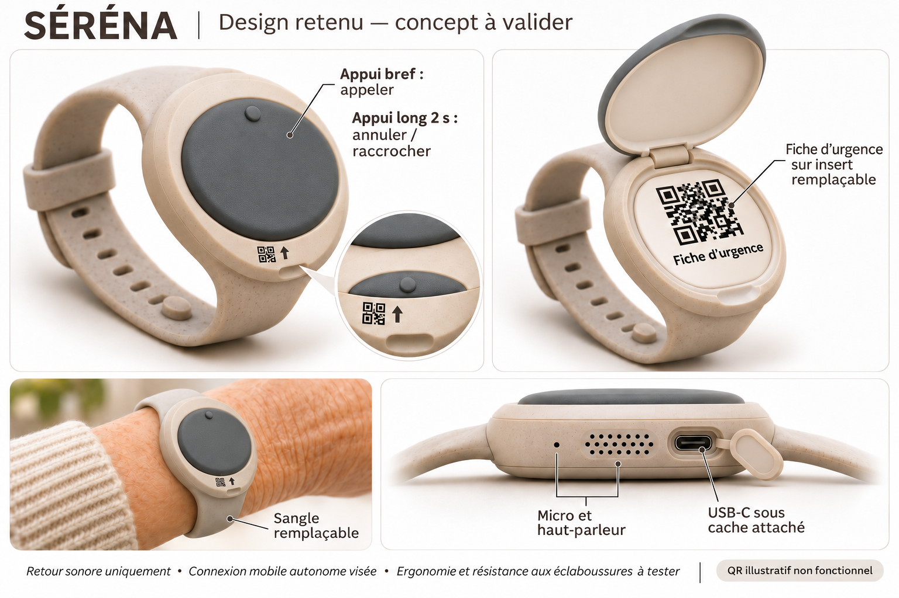
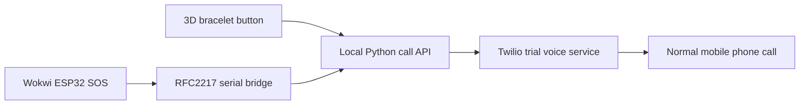

# SÉRÉNA — safety bracelet prototype

Interactive 3D bracelet, ESP32 electrical simulation, and a local bridge that can trigger a real demonstration phone call.



*User-supplied concept reference. The enclosure and physical electronics still require validation.*

## Start

From the repository root:

```sh
python -m pip install -r requirements.txt
python manage.py run
```

Open **http://localhost:5176/bracelet/** and keep the terminal open. The 3D view works without telephone credentials; real calls remain disabled until configured. No JavaScript build or npm install is needed to run the page.

On the existing Windows workstation, the saved encrypted calling settings are reused automatically. From the `nora-embedded` folder, the compatibility command is still:

```powershell
python ../nora-design/serve.py
```

## Controls

- **Brief press:** request the demonstration call. There is no programmed countdown.
- **Hold 2 seconds:** request hang-up/cancellation. If the provider cannot confirm hang-up, end the call on the phone.
- Open the lid to inspect the illustrative emergency-card insert.
- Rotate the 3D object, change finishes, and inspect the separate hardware reference view.

Actual ringing depends on the telephone service and network; “immediate” means there is no artificial five-second wait. This demonstration calls a normal mobile through Twilio's supported trial scenario. It does not provide live voice through a physical bracelet.

## Use the Wokwi circuit button

1. Start the combined server with `python manage.py run`.
2. Build with `python manage.py build`.
3. Open `nora-embedded` in VS Code and run **Wokwi: Start Simulator**.
4. Keep the simulator visible. Release SOS once after boot, then briefly click the red circuit button.

The launcher waits for Wokwi's RFC2217 serial server on **localhost:4000**. Only an explicit firmware SOS event requests a call; boot and status output do not. Wokwi requires its own valid license. See [the firmware guide](nora-embedded/README.md).



## Configure real demonstration calls

On Windows:

```powershell
./nora-call-demo/start-phone.ps1
```

Enter your own account credentials, verified destination and the trial caller number assigned to that destination. Settings are encrypted for the current Windows user under ignored `.local/`; they are never included in the repository. The launcher can reuse a caller number from a previous successful call to the same destination.

For another platform, supply the environment variables listed in [.env.example](.env.example), then run the server. The application reads process environment variables; it does not load `.env` automatically. Read [the calling guide](nora-call-demo/README.md) for provider restrictions and troubleshooting.

## Build and test

Run `make help` to list commands, from either the repository root or `nora-embedded`.
If Make is unavailable on Windows, use `python manage.py --help` from the root,
or `python ../manage.py --help` from `nora-embedded`.

| Task | Any platform | With Make installed |
| --- | --- | --- |
| Install runtime | `python manage.py setup` | `make setup` |
| Install build dependencies | `python manage.py setup-dev` | `make setup-dev` |
| Run 3D + calling backend | `python manage.py run` | `make run` |
| Run software tests | `python manage.py test` | `make test` |
| Build jury firmware | `python manage.py build` | `make build` |
| Check sources and tests | `python manage.py check` | `make check` |
| Inspect local tools | `python manage.py doctor` | `make doctor` |
| Remove generated caches | `python manage.py clean` | `make clean` |

Python 3.10+ is required; Python 3.12 is used for verification. Native firmware tests need `g++`. Firmware compilation uses PlatformIO. JavaScript tests require Node.js 22+; CI requires them, while local Python/C++ testing can skip them when Node is absent. **Automated tests use fake providers and never place phone calls.**

Firmware profiles:

- `xiao_jury_demo`: short-press presentation workflow with local serial call bridge (default).
- `xiao_esp32c3`: isolated engineering simulation with hold/countdown and modem mock.
- `xiao_sim7600_bench`: experimental physical SIM7600 adapter, blocked until contact/operator qualification is configured.

Select another profile with `python manage.py build --environment xiao_esp32c3` or `make build ENV=xiao_esp32c3`.

## Project layout

```text
nora-design/       Three.js bracelet, materials, interaction and frontend tests
nora-call-demo/    Local phone API, serial bridge, encrypted settings and tests
nora-embedded/     ESP32 firmware, Wokwi diagram, native tests and hardware studies
scripts/          Publishable-source checks
.github/          Automated tests and firmware builds
manage.py         Cross-platform commands
Makefile          Convenience targets for the same commands
```

The legacy NORA folder names are retained so existing launch paths and tooling continue to work. Earlier unrelated experiments and generated local tools are excluded from this repository.

## Hardware resources and validation

- [Subsystem/interface diagram](nora-embedded/hardware/system.svg)
- [Hardware guide and assumptions](nora-embedded/hardware/README.md)
- [Component list](nora-embedded/hardware/bom.csv)
- [Wiring reference](nora-embedded/hardware/wiring.csv)
- [Verification record](docs/VERIFICATION.md)

The simulation and successful demonstration phone call do **not** establish a working standalone cellular bracelet. Physical power, charging, battery protection, modem/SIM/VoLTE, antennas, audio, fit and manufacturing still need bench testing. The QR patterns are illustrative and contain no medical data.

See [CONTRIBUTING.md](CONTRIBUTING.md) and [THIRD_PARTY.md](THIRD_PARTY.md). No account credentials, phone numbers, local tools or generated firmware should be committed.
